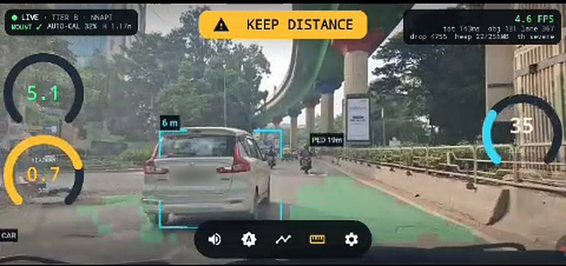
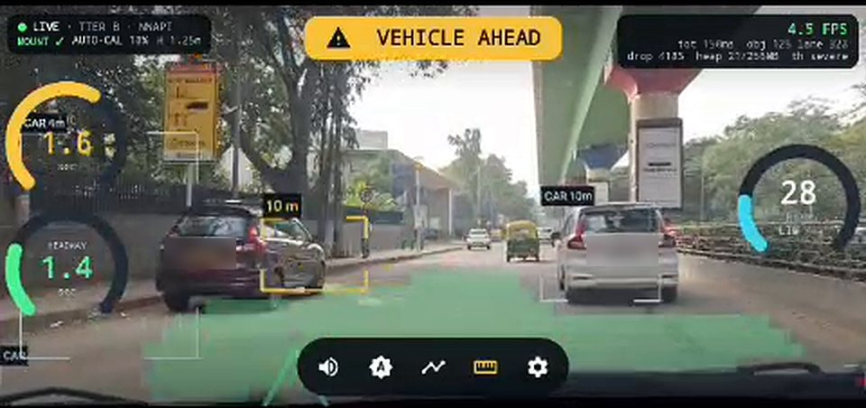
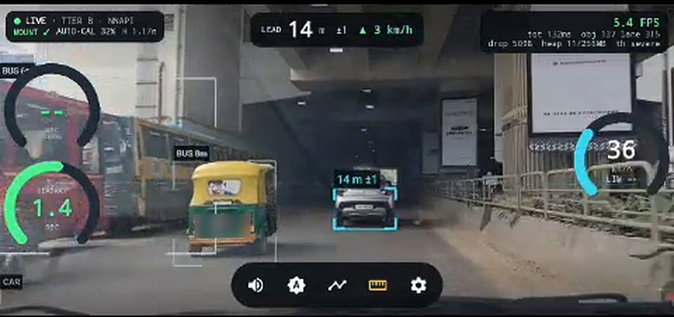
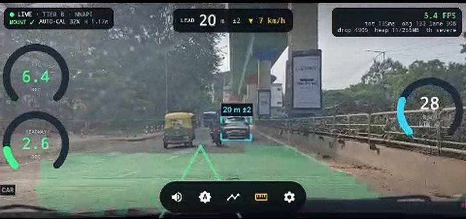
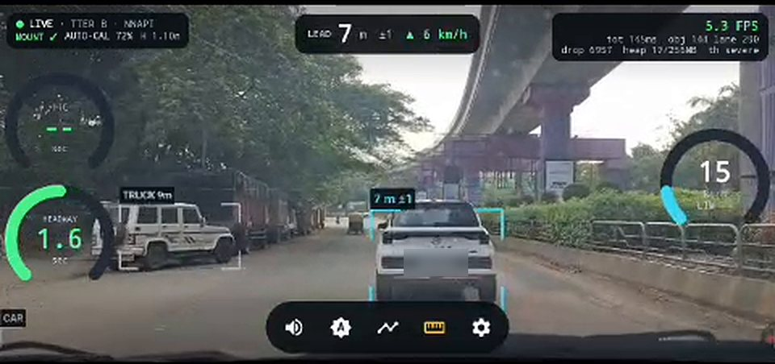
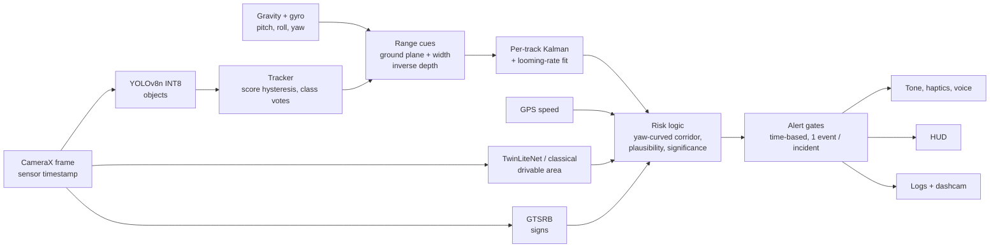

<div align="center">

# Lyne ADAS

### Real-time, on-device driver assistance for any Android phone.

Forward-collision, pedestrian, tailgating, lane-departure and speed-sign warnings from your phone's camera.
No cloud, no account, works offline. One APK that tunes itself from a 2 GB budget phone to a flagship.


[**Website**](https://sherin-sef-ai.github.io/Lyne-ADAS/) · [**Download APK**](https://github.com/Sherin-SEF-AI/Lyne-ADAS/releases/latest) · [**Architecture**](ARCHITECTURE.md) · [**Models**](models/README.md) · [**Validation**](VALIDATION.md) · [**Safety**](#safety-and-limitations)

<br>



<sub>Real drive, Bengaluru · Galaxy A17 (Tier B) · number plates blurred</sub>

</div>

---

## What it is

Lyne is a **warning-only (Level 1) driver assistance system**. Mount the phone on the windshield and it watches
the road: vehicles you are closing on, pedestrians and riders in your path, tailgating, lane drift and speed
limits. Every model runs on the phone. Nothing leaves the device.

## On the road

Screen recordings from a 9.5-minute city drive in Bengaluru on a budget phone (Galaxy A17, Tier B, NNAPI),
running at 4–6 fps even while the phone was thermally throttled.

| | |
|---|---|
|  |  |
| **Cut-in.** A car cuts in at 10 m; TTC 1.6 s triggers the caution. | **Mixed traffic.** Only the car in your path is the lead (14 m ±1). |
|  |  |
| **Relaxed following.** 20 m ±2, headway 2.6 s, so it stays quiet. | **Stop and go.** 7 m ±1 at 15 km/h; close but safe at that speed. |

The same drive exposed a bug: a false "car" detection on the dashboard held the lead at 1 m for the first
three minutes. It's fixed (range expires after 0.8 s without a measurement and dashboard boxes are ignored,
with regression tests). The general-purpose detector also sometimes labels auto-rickshaws as buses and
riders as pedestrians, which is what the Indian-roads model on the roadmap is for. Real drives find what
simulations miss, so please share yours.

## v2: accuracy first

v1 received public feedback, including a side-by-side drive logged against a car's radar. Distance was
off by about 10 m on average, and most collision warnings didn't match a real hazard. The diagnosis was
right: v1 estimated distance **from box size alone**, so a pixel of detector jitter turned into metres of range
noise, which then turned into phantom collision warnings.

v2 rebuilds the chain from pixels to alerts:

| Problem in v1 | What v2 does |
|---|---|
| Distance from box width only (an SUV "looked" closer than a hatchback) | **Two independent range cues.** Ground-plane geometry (camera height + horizon) fused with a width prior by inverse variance. Each vehicle's real width is **learned** while it is close, so pickups and SUVs are not misjudged |
| Range filtered in metres (biased short) | Fusion and filtering in **inverse depth** (1/d), where pixel noise is Gaussian and unbiased |
| Frame-to-frame jitter | **Per-object Kalman filter** (range + closing speed) with outlier gating. The HUD shows `24 m ±2`, not a falsely precise number |
| TTC from differencing two noisy frames | **Recency-weighted least-squares looming rate** fused with Kalman range-rate. A warning needs the closing to be **statistically significant** (≥2σ for caution, ≥3σ for brake) |
| Fixed screen band for "in my lane" | **Metric corridor** (metres, not pixels), curved by the gyro yaw rate. Parked cars and the next lane no longer count |
| Gyro read on the wrong axis for a windshield mount | Yaw = gyro projected on the gravity "up" vector, so it works for any mount |
| Horizon assumed at mid-frame | Mount **pitch and roll from the gravity sensor**, gated against acceleration |
| Camera height unknown | Vehicle presets + **online self-calibration** from ordinary traffic statistics |
| FoV of the full sensor, not the analysis stream | Active-array FoV, corrected for the stream's crop |
| Warnings counted every frame | **One event per incident**, time-based onset and hysteresis (same behaviour at 8 fps and 30 fps) |
| Alarms in creeping traffic or on noise spikes | Plausibility gates: closing speed can't exceed own speed, FCW armed above 10 km/h, mature tracks only |
| A single misread speed sign triggered overspeed | Same limit must be read twice (or once at very high confidence) |

### Measured, reproducibly

`app/src/test` replays synthetic drives through a pinhole camera with realistic detector noise
(1.3 px per box edge at 256 px input, 5% missed detections, road bounce) and runs **v1 and v2 side by side**:

| Scenario | v1 | v2 |
|---|---|---|
| False collision warnings, 20 min random traffic (true TTC never under 12 s) | 626 | **0** |
| False warnings, 2 min steady following at 30 m (8 / 15 / 30 fps) | 10 / 112 / 514 | **0 / 0 / 0** |
| Mean range error, hatchback / sedan / pickup at 8 to 60 m (with 5 cm height and 0.3° pitch calibration error) | 7.9 m | **2.0 m** |
| Distance jitter at 30 m (std dev) | 5.0 m | **1.0 m** |
| Lead brakes at 6 m/s² from 35 m at 80 km/h: caution / brake at real TTC (median of 8 runs) | | **≈1.5 s / ≈0.8 s** |
| Gentle approach, closing at 18 km/h: caution at real TTC | | **2.1 s** |
| Camera height configured as 1.20 m, true 1.45 m: auto-calibration learns | | **1.42 m** |

```bash
./gradlew :app:testDebugUnitTest   # prints the numbers above
```

These are simulations, not road certification. Real-world accuracy depends on mount, road slope,
lighting and calibration. **Measure it yourself:** the in-app **Calibrate → Range check** gives a parked
known-gap result in minutes. `tools/validate_accuracy.py` compares drive logs against radar or lidar and
audits warnings for false alarms and misses. The protocol is in [VALIDATION.md](VALIDATION.md). Please share
your results in an issue.

## Features

| | |
|---|---|
| **Forward collision warning** | Fused, significance-tested TTC; caution chirp, then a repeating brake alarm |
| **Pedestrians and riders** | Risk from range, time-to-reach at your speed and corridor overlap; quiet while you are stopped at a crossing |
| **Headway / tailgating** | Following time in seconds, warns above 30 km/h after sustained tailgating |
| **Lane departure** | On drivable-area segmentation, curve-aware, suppresses deliberate manoeuvres |
| **Speed signs + overspeed** | GTSRB classifier with two-read confirmation, compared with GPS speed |
| **Traffic moving** | Chime when the car ahead pulls away in stop-and-go traffic |
| **Voice alerts** | Short offline cues ("Brake", "Pedestrian", "Speed limit 60") via the system TTS |
| **Event dashcam** | Ring buffer keeps a clip around every critical warning |
| **Trip history** | Route map, stats and an event timeline for every drive |
| **Accuracy tools** | In-app parked range check, per-frame CSV log, and a validation script for radar or lidar comparisons |
| **Guided calibration** | Live level bubble, vehicle-height presets, FoV, known-gap check, auto-cal status |
| **Auto day / night** | Ambient-light-driven HUD theme |

## How it works



The camera analyzer never blocks. It copies each frame into a pooled buffer and hands it to a single
inference thread, dropping frames when busy. Segmentation runs on its own thread. The hot path allocates
nothing per frame, and the new fusion math is O(tracks) per frame (microseconds), so it adds nothing
measurable on budget phones. Details are in [ARCHITECTURE.md](ARCHITECTURE.md).

## One APK, every phone

A capability probe (RAM, cores, GPU, NNAPI and a CPU micro-benchmark) picks a tier in under 3 seconds:

| | Tier A | Tier B | Tier C |
|---|---|---|---|
| Object model | YOLOv8n 320 | YOLOv8n 256 | YOLOv8n 256 |
| Drivable area | Neural | Neural (async) | Classical |
| Backend | NNAPI / GPU | NNAPI / GPU | XNNPACK CPU |
| Pixel format | ARGB_8888 | ARGB_8888 | RGB_565 |
| Speed signs | On | On | Off |
| Target FPS | 30 | 15 | 8 |

Thermal status and memory pressure stretch the cadence at runtime and recover once the phone cools. The alert logic
is time-based, so warnings behave the same at 8 fps and at 30 fps.

## Quick start

**Try it:** download the APK from [Releases](https://github.com/Sherin-SEF-AI/Lyne-ADAS/releases/latest) and sideload it.

**Build from source** (JDK 17, Android SDK 35):

```bash
git clone https://github.com/Sherin-SEF-AI/Lyne-ADAS.git
cd Lyne-ADAS
./gradlew :app:assembleDebug
adb install -r app/build/outputs/apk/debug/app-debug.apk
```

minSdk 26 · target 35 · Kotlin 2.1 · Jetpack Compose · CameraX 1.4 · LiteRT 1.0

## Setup for best accuracy

1. **Mount** the phone in landscape, high and centred on the windshield, lens clean. Aim slightly down.
2. **Calibrate → Camera height:** pick your vehicle type. The level bubble confirms tilt and roll.
3. **Grant location.** Speed lets Lyne arm FCW only when moving, time headway, and reject impossible closing speeds.
4. **Drive.** Auto-calibration refines the camera height from passing cars. Progress shows as `AUTO-CAL` in the HUD.
5. Optional: **known-gap check** against a measured distance.

## Models

| Model | Job | Format |
|---|---|---|
| YOLOv8n (COCO) | Vehicles, people, two-wheelers, stop signs | INT8 TFLite |
| TwinLiteNet | Drivable-area segmentation | TFLite |
| GTSRB MobileNetV3 | Speed-limit classification | INT8 TFLite |
| Classical CV | Model-free drivable area for entry devices | Kotlin |

Conversion scripts and an India Driving Dataset fine-tuning recipe are in [models/](models/README.md).

## Roadmap

- [x] Multi-cue range, inverse-depth Kalman tracking, significance-tested TTC
- [x] IMU mount estimation and traffic-based auto-calibration
- [x] Event dashcam, trip history, accuracy CSV, voice alerts
- [ ] Brake-light detection as an early lead-deceleration cue
- [x] Road-tested in Bengaluru traffic; fixes for low-fps tracking, duplicate boxes and stale range
- [ ] Indian-roads detector (auto-rickshaws, riders, animals) trained on openly licensed dashcam data
- [ ] Public real-world accuracy dataset (radar-referenced)
- [ ] CI with the simulation suite on every PR

## Safety and limitations

> **Lyne is a warning-only aid. It never controls the vehicle. Keep your eyes on the road and your hands on the wheel.**

- Range and TTC are monocular **estimates** that assume a flat road. Uncertainty grows with distance: expect roughly ±5–10% at 20 m and more beyond 50 m. Hills, heavy occlusion and unusual vehicles reduce accuracy.
- Low-confidence estimates are never escalated to a brake alarm.
- Detection quality depends on light, weather, windshield glare and the phone's camera.
- This is research and educational software provided as is, without warranty. It is not a certified safety system.

## Contributing

Issues and PRs are welcome, especially **real-world logs** (Accuracy CSV plus a reference distance source), new
test scenarios in `app/src/test`, and model improvements. Keep `./gradlew :app:testDebugUnitTest` green: the
simulation suite enforces zero false collision warnings in the steady-following and soak scenarios.

## Author

**sherin joseph roy** · sherin.joseph2217@gmail.com · https://github.com/Sherin-SEF-AI

## License

[MIT](LICENSE)

<div align="center">

**If Lyne is useful to you, a star helps others find it.**

</div>
